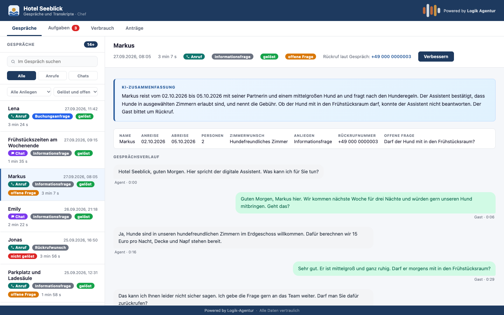
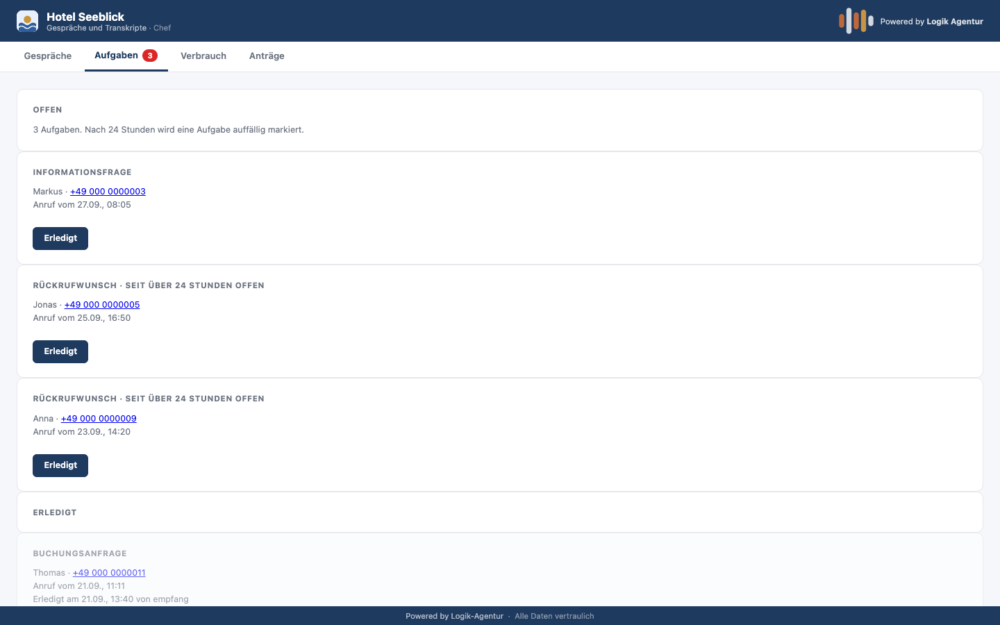
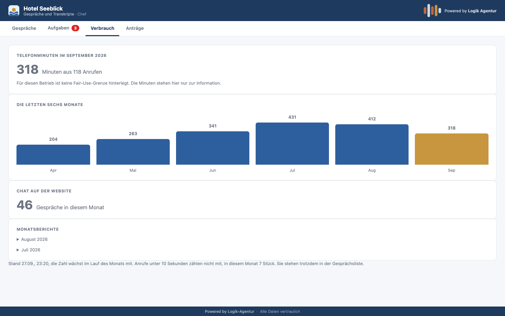
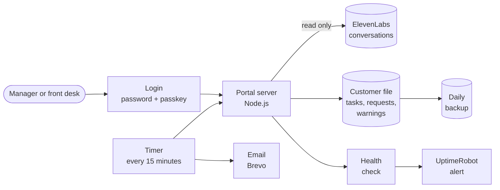

<h1 align="center">Customer Portal for AI Agents</h1>

  The business sees what its AI agents handled on the phone and in chat: 
  summaries, open tasks, usage. On its own server in Germany.

  
  
  
  
  

<a href="README.md">Deutsch</a> · <b>English</b>

All images show a replica with invented data and the German-language interface. The hotel "Seeblick" does not exist.

---

## What is it about?

An AI agent that answers calls is only as good as what happens afterwards. The business needs to
see what was discussed, what is still open and who takes care of it. Without access to a
developer account and without call data going back and forth by email.

The portal is exactly that place. In the morning, the front desk sees what came in overnight and
ticks off callbacks. Management reports when the assistant should answer something better.

## What it does

**Conversations**
- All phone and chat conversations with summary and transcript
- Search, filters by topic and by status: resolved, not resolved, open question
- Marker when the assistant could not answer a question, with the question quoted verbatim

**Tasks**
- Conversations with a callback request or booking inquiry automatically become a task, each conversation at most once
- "Done" with one click in the portal or via a link in the task email, with a confirmation page
- A task stores no guest data. Name and request are fetched fresh from the conversation on every view
- Notice when a task has been open for too long

**Usage**
- Minutes per month, recorded to the second
- Warning at 80 and 100 percent of the agreed volume
- Monthly report by email, totals only, no guest data

**Change requests**
- The business does not change the assistant itself. It reports from within a conversation what
  should be improved and follows the status of its request

<table>
  <tr>
    <td></td>
    <td></td>
  </tr>
</table>

## Architecture

Conversations are not stored a second time. The portal reads them from the provider and displays
them. Its own data is limited to tasks, change requests and usage warnings.

## Operations and security

| Topic | Implementation |
|---|---|
| Login | Password plus passkey as second factor |
| Roles | Manager sees everything, front desk sees conversations and tasks but no usage and no change requests. Enforced on the server, not just in the interface |
| Tenant separation | Each business only sees its own conversations, even when calling an address directly |
| Monitoring | A health check reports whether every phone number is assigned to its assistant and the timer is running. The alert chain was tested by deliberately triggering a real incident |
| Backup | Daily backup of the customer file |
| Mobile | Tested on iPhone and improved |

## Privacy

| Principle | Implementation |
|---|---|
| Server location | Hetzner, Germany |
| No second archive | Conversations stay with the provider and are deleted there after 90 days |
| Storage limitation | Free text in change requests is deleted automatically after 90 days |
| Data minimisation | The monthly report contains only totals and timestamps, no guest data |

## Quality assurance

- 26 acceptance criteria, defined and frozen before building
- Built in small steps, with evidence and sign-off after each step
- Every change on the live server with checksums before and after and a rollback point

## How it was built

Concept, roles, privacy and acceptance testing are mine. The implementation is AI-assisted with
Claude Code. The portal belongs to the [AI phone agent](https://github.com/pnanis-alt/ki-telefonagent-hotel/blob/main/README.en.md)
and displays its conversations.

---

As of 27 September 2026. Source code and server configuration are private.
Contact: [LinkedIn](https://www.linkedin.com/in/pantelis-nanis) · [Logik-Agentur](https://logik-agentur.de)
