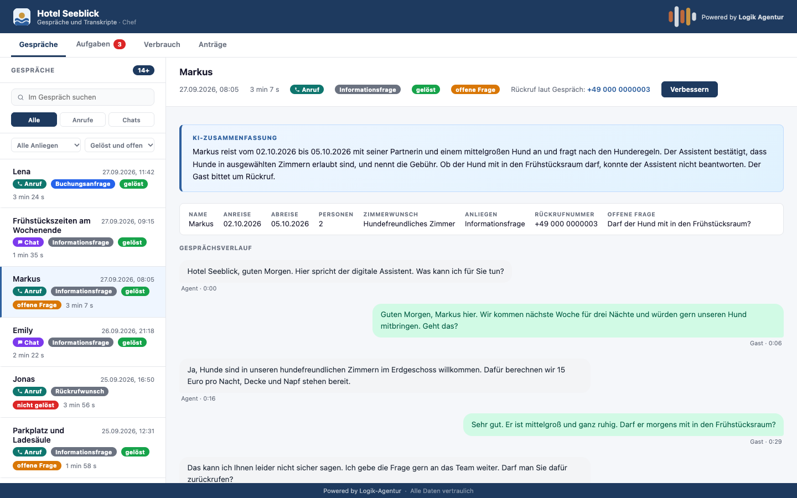
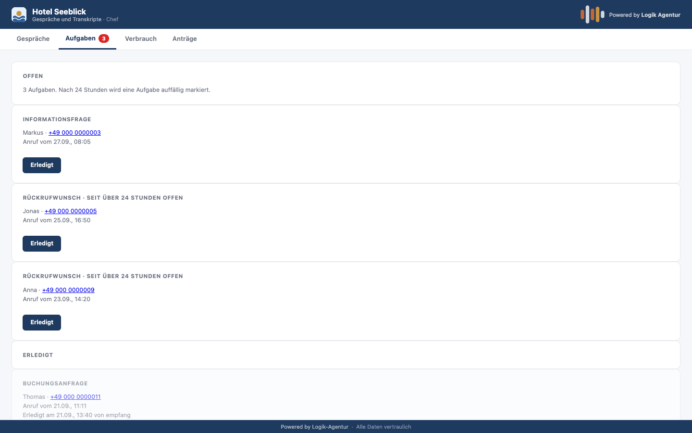
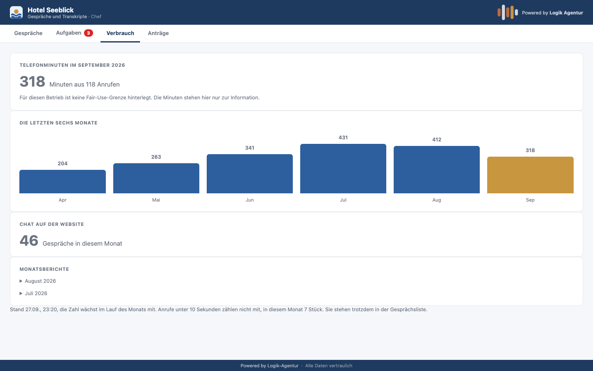
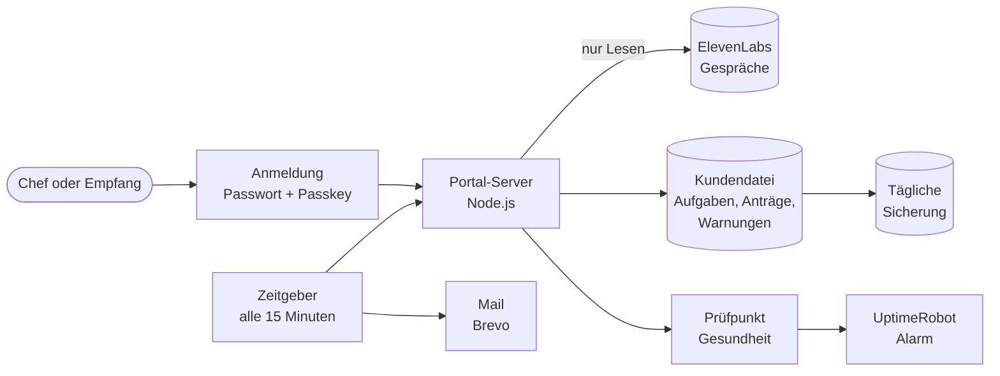

<h1 align="center">Kunden-Portal für KI-Agenten</h1>

  Der Betrieb sieht, was seine KI-Agenten am Telefon und im Chat erledigt haben: 
  Zusammenfassungen, offene Aufgaben, Verbrauch. Auf eigenem Server in Deutschland.

  
  
  
  
  

<b>Deutsch</b> · <a href="README.en.md">English</a>

Alle Bilder zeigen einen Nachbau mit erfundenen Daten. Das Hotel "Seeblick" gibt es nicht.

---

## Worum geht es?

Ein KI-Agent, der Anrufe annimmt, ist nur so gut wie das, was danach passiert. Der Betrieb muss
sehen, was besprochen wurde, was offen ist und wer sich darum kümmert. Ohne Zugang zu einem
Entwickler-Konto und ohne Gesprächsdaten per Mail hin und her.

Das Portal ist genau dieser Ort. Die Rezeption sieht morgens, was über Nacht angekommen ist, und
hakt Rückrufe ab. Die Leitung meldet, wenn der Assistent etwas besser beantworten soll.

## Was es kann

**Gespräche**
- Alle Gespräche von Telefon und Chat mit Zusammenfassung und Verlauf
- Suche, Filter nach Anliegen und nach Stand: gelöst, nicht gelöst, offene Frage
- Kennzeichnung, wenn der Assistent eine Frage nicht beantworten konnte, mit der Frage im Wortlaut

**Aufgaben**
- Gespräche mit Rückrufwunsch oder Buchungsanfrage werden automatisch zur Aufgabe, jedes Gespräch höchstens einmal
- "Erledigt" per Klick im Portal oder über einen Link in der Aufgabenmail, mit Bestätigungsseite
- Eine Aufgabe speichert keine Gästedaten. Name und Anliegen werden bei jeder Anzeige frisch aus dem Gespräch geholt
- Hinweis, wenn eine Aufgabe zu lange offen liegt

**Verbrauch**
- Minuten je Monat, sekundengenau erfasst
- Warnung bei 80 und 100 Prozent der vereinbarten Menge
- Monatsbericht per Mail, nur mit Summen, ohne Gästedaten

**Anträge**
- Der Betrieb ändert nichts selbst am Assistenten. Er meldet aus dem Gespräch heraus, was besser
  werden soll, und verfolgt den Stand seines Antrags

<table>
  <tr>
    <td></td>
    <td></td>
  </tr>
</table>

## Aufbau

Die Gespräche werden nicht ein zweites Mal gespeichert. Das Portal liest sie beim Anbieter und
zeigt sie an. Eigene Daten sind nur Aufgaben, Anträge und Verbrauchswarnungen.

## Betrieb und Sicherheit

| Thema | Umsetzung |
|---|---|
| Anmeldung | Passwort und Passkey als zweiter Faktor |
| Rollen | Chef sieht alles, Empfang sieht Gespräche und Aufgaben, aber keinen Verbrauch und keine Anträge. Geprüft am Server, nicht nur in der Anzeige |
| Mandantentrennung | Jeder Betrieb sieht nur seine eigenen Gespräche, auch beim direkten Aufruf einer Adresse |
| Überwachung | Ein Prüfpunkt meldet, ob jede Telefonnummer ihrem Assistenten zugewiesen ist und der Zeitgeber läuft. Die Alarmkette wurde mit einem echten, künstlich ausgelösten Vorfall getestet |
| Sicherung | Tägliche Sicherung der Kundendatei |
| Handy | Auf dem iPhone getestet und nachgebessert |

## Datenschutz

| Grundsatz | Umsetzung |
|---|---|
| Serverstandort | Hetzner, Deutschland |
| Kein zweites Archiv | Gespräche bleiben beim Anbieter und fallen dort nach 90 Tagen weg |
| Speicherbegrenzung | Freitexte in Anträgen werden nach 90 Tagen automatisch gelöscht |
| Datensparsamkeit | Der Monatsbericht enthält nur Summen und Zeitpunkte, keine Gästedaten |

## Qualitätssicherung

- 26 Prüfkriterien, vor dem Bau festgelegt und eingefroren
- Gebaut in kleinen Schritten, nach jedem Schritt Nachweis und Abnahme
- Jede Änderung am Live-Server mit Prüfsumme vorher und nachher und einem Rücksprungpunkt

## Wie gebaut

Konzept, Rollen, Datenschutz und Abnahme liegen bei mir. Die Umsetzung erfolgt KI-gestützt mit
Claude Code. Das Portal gehört zum [KI-Telefonagenten](https://github.com/pnanis-alt/ki-telefonagent-hotel)
und zeigt dessen Gespräche an.

---

Stand: 27.09.2026. Quellcode und Serverkonfiguration sind privat.
Kontakt: [LinkedIn](https://www.linkedin.com/in/pantelis-nanis) · [Logik-Agentur](https://logik-agentur.de)
